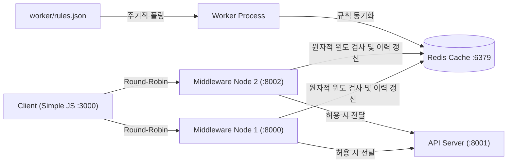

# 처리율 제한 장치 설계 및 구현 (Rate Limiter)

## 1. 목적

클라이언트의 잦은 요청을 제한하여 시스템 전체 처리량을 보호하고, 다중 서버 환경에서도 일관되게 동작하는 처리율 제한 시스템을 설계 및 학습한다.

## 2. 요구사항

- 설정된 처리율(윈도 크기 및 최대 요청 횟수 등)을 초과하는 요청을 경계 폭주 없이 일관되게 제한한다.
- 처리율 제한 규칙은 무중단으로 반영할 수 있도록 외부 설정 파일로 관리하며, 별도의 작업 프로세스(Worker)를 통해 캐시에 동기화한다.
- 다중 미들웨어 서버가 동시에 요청을 처리하더라도 단일 상태를 공유하며 경쟁 조건(Race Condition) 없이 정확한 한도를 유지한다.
- 요청 처리 및 제한 시 HTTP 응답 헤더를 통해 처리율 제한 상태와 처리 노드 정보를 사용자에게 알린다.

## 3. 설계

### 3-1. 개념적 설계: 핵심 프로세스 및 알고리즘

#### 핵심 프로세스

시스템의 동작은 **규칙 동기화 흐름**과 **요청 처리 흐름** 두 가지로 나뉜다.

1. **규칙 동기화 흐름**
   - 작업 프로세스(Worker)가 디스크의 설정 파일을 주기적으로 읽어 처리율 제한 규칙(윈도 크기, 허용 요청 수 등)을 중앙 캐시에 반영한다.
2. **요청 처리 흐름**
   - 클라이언트(JS)가 다중 미들웨어 인스턴스 중 하나에 HTTP 요청을 전송한다.
   - 미들웨어는 중앙 캐시에서 제한 규칙과 해당 클라이언트의 최근 요청 이력을 확인해 한도 도달 여부를 판단한다.
   - 한도 미만이면 요청 이력을 기록한 뒤 API 서버로 전달(Proxy)하고, 제한 상태 헤더를 포함해 응답한다.
   - 한도에 도달했다면 API 서버로 전달하지 않고 즉시 `429 Too Many Requests` 응답과 대기 안내 헤더를 반환한다.

#### 알고리즘: 고정 윈도 카운터의 한계와 이동 윈도 로그 채택

초기 단순 모델로 많이 쓰이는 **고정 윈도 카운터(Fixed Window Counter)** 대신 **이동 윈도 로그(Sliding Window Log)** 알고리즘을 채택했다.

| 구분               | 고정 윈도 카운터 (Fixed Window Counter)                                                      | 이동 윈도 로그 (Sliding Window Log)                                            |
| :----------------- | :------------------------------------------------------------------------------------------- | :----------------------------------------------------------------------------- |
| **동작 원리**      | 고정된 시간 구간(예: `00:00~00:10`) 단위로 요청 수를 카운트                                  | 매 요청 시점 기준 **직전 N초(`[현재 - 윈도, 현재]`)** 동안의 요청 이력을 계산  |
| **경계 폭주 문제** | 구간 경계(`00:09`와 `00:10`)에 요청이 몰리면 **짧은 순간에 한도의 2배가 통과**되는 현상 발생 | 고정된 경계가 존재하지 않아 **어느 시점의 구간을 잘라도 한도를 초과하지 않음** |
| **사용자 체감**    | 윈도가 리셋되는 시점에 따라 허용/차단 주기가 불규칙하게 느껴짐                               | 가장 오래된 요청이 만료되는 순서대로 1칸씩 열려 일관된 사용감 제공             |

- **채택 사유:** 고정 윈도의 경계 폭주 문제를 근본적으로 제거해 사용자 입장에서 예측 가능하고 일관된 제한을 제공하며, 타임스탬프 기반 정렬 자료구조를 학습하기에 가장 직관적이기 때문이다.

#### 사용자 알림 및 분산 추적용 응답 헤더 명세

- `X-Ratelimit-Limit`: 윈도당 클라이언트가 전송할 수 있는 최대 요청 수
- `X-Ratelimit-Remaining`: 현재 이동 윈도 내 남은 처리 가능 요청 수 (초과 시 `0`)
- `X-Ratelimit-Retry-After`: 한도 제한에 걸렸을 때 몇 초 뒤에 재요청할 수 있는지 안내 (허용 시 `0`, 차단 시 가장 오래된 허용 요청이 만료될 때까지 남은 초)
- `X-Served-By`: 다중 미들웨어 환경에서 해당 요청을 실제로 처리한 미들웨어 노드 식별자

---

### 3-2. 논리적 설계: 시스템 아키텍처 및 자료구조



#### 노드 구성 및 분산 동기화

1. **클라이언트 (Simple JS):** 라운드로빈 방식으로 미들웨어 Node 1(`8000`)과 Node 2(`8002`)에 번갈아 요청을 보내며, 서로 다른 노드가 응답하더라도 처리율 한도가 통합 공유됨을 확인한다.
2. **처리율 제한 미들웨어 (Stateless 다중 노드):** 내부 메모리에 상태를 저장하지 않고 모든 판단을 중앙 Redis에 위임하므로, 노드를 수평 확장(Scale-out)해도 별도 서버 간 동기화가 필요 없다. 다중 서버 간 시계 오차(Clock Skew)를 막기 위해 시간 기준도 중앙 캐시 서버의 시각으로 통일한다.
3. **API 서버 (FastAPI):** 미들웨어를 통과한 정상 요청만 수신해 응답한다.
4. **작업 프로세스 (Python Worker):** `worker/rules.json`을 주기적으로 읽어 변경된 정책을 Redis에 반영한다.
5. **캐시 (단일 Redis):** 처리율 제한 알고리즘의 본질에 집중하기 위해 캐시 노드 자체의 클러스터링은 배제하고 단일 인스턴스로 구성한다.

#### 이동 윈도 로그의 논리적 처리 흐름

1. **만료 이력 정리:** 현재 시각에서 윈도 크기를 뺀 기준 시점(`현재 - 윈도`)보다 오래된 요청 이력을 모두 제거한다.
2. **유효 요청 수 확인:** 현재 윈도 안에 남아 있는 유효 요청 개수를 센다.
3. **판정 및 후속 처리:**
   - **한도 미만(허용):** 이번 요청을 이력에 새로 기록하고, 전체 이력 보관 만료 시간을 갱신한 뒤 API 서버로 전달한다.
   - **한도 이상(차단):** **차단된 요청은 이력에 기록하지 않는다.** _(재시도 연타로 윈도가 계속 연장되는 부작용 방지)_ 대신 남아 있는 이력 중 **가장 오래된 요청의 시각**을 조회해 재시도 가능 대기 시간을 계산하여 `429` 응답으로 반환한다.

#### Redis Sorted Set 자료구조 개념 (`Key`, `Score`, `Member`)

이동 윈도 로그는 Redis의 **정렬 집합(Sorted Set, `ZSET`)** 자료구조를 기반으로 동작한다. Sorted Set은 중복 없는 항목들을 숫자 기준값에 따라 자동 오름차순 정렬해 주는 집합이다.

| 구성 요소  | 본 시스템에서의 매핑          | 역할 및 설계 의도                                                                                                                       |
| :--------- | :---------------------------- | :-------------------------------------------------------------------------------------------------------------------------------------- |
| **Key**    | `rate_limit:sw:{client_id}`   | 미들웨어가 특정 클라이언트(client_id)의 요청 이력을 격리하여 관리하기 위한 식별 키                                                      |
| **Score**  | 요청 시각 (밀리초 타임스탬프) | 데이터를 자동 오름차순 정렬하는 기준 숫자. 이 값을 활용하면 특정 시각 이전의 만료 로그만 한 번에 범위 삭제할 수 있음                    |
| **Member** | `{타임스탬프}:{고유 요청 ID}` | Sorted Set에 저장되는 개별 요청 식별자. 동일 밀리초(ms) 내 중복 요청이 덮어씌워져 카운트가 누락되는 것을 방지하기 위해 고유 ID를 결합함 |

#### 설정 파일 (`worker/rules.json`)

```json
{
  "window_seconds": 10,
  "limit": 5,
  "sync_interval_seconds": 3
}
```

---

### 3-3. 물리적 설계: 프로세스 배치, 기술 스택 및 원자적 스크립트 구현

#### 프로세스 배치 (6개 독립 실행 단위)

| 노드                       | 실행 형태                                  | 기본 포트 / 주소 | 비고                               |
| :------------------------- | :----------------------------------------- | :--------------- | :--------------------------------- |
| **Redis 캐시**             | Docker 단일 컨테이너 (`redis:7-alpine`)    | `localhost:6379` | Sorted Set & 원자적 스크립트 실행  |
| **작업 프로세스 (Worker)** | Python 프로세스 (`-m worker.worker`)       | -                | `worker/rules.json` 폴링 및 동기화 |
| **API 서버**               | Python 프로세스 (`uvicorn`)                | `localhost:8001` | 순수 백엔드 응답 역할              |
| **미들웨어 Node 1**        | Python 프로세스 (`uvicorn`)                | `localhost:8000` | `NODE_ID=middleware-1`             |
| **미들웨어 Node 2**        | Python 프로세스 (`uvicorn`)                | `localhost:8002` | `NODE_ID=middleware-2`             |
| **클라이언트**             | Python 동적 정적 서버 (`-m client.server`) | `localhost:3000` | 라운드로빈 시연 및 시각적 대시보드 |

#### 기술 스택 선정

- **FastAPI + httpx:** 단순 백엔드 응답 및 비동기 프록시 미들웨어를 빠르게 구성하기 위해 사용
- **Redis:** 인메모리 기반의 빠른 읽기/쓰기와 Sorted Set·Lua Script 기능을 내장해 동시성 제어 시연에 적합
- **Simple JS:** 별도 빌드 도구 없이 브라우저에서 상태 변화와 노드 분산 결과를 직관적으로 관찰하기 위해 순수 JS 사용

#### 동시성 제어와 Redis Lua Script (`middleware/sliding_window_log.lua`)

다중 미들웨어(Node 1, Node 2)가 동시에 요청을 받아 `만료 삭제 → 개수 확인 → 이력 추가`를 개별 네트워크 요청으로 따로 호출하면, 두 요청이 `개수 확인`을 동시에 통과해 한도를 넘는 '경쟁 조건(Race Condition)'이 발생한다.

1. **Lua Script가 원자성을 보장하는 원리:**
   - Redis는 단일 스레드로 동작하기 때문에 한 번에 하나의 작업만 끝까지 처리한 뒤 다음 요청으로 넘어간다.
   - 여러 명령을 하나의 Lua Script로 묶어 전달하면 Redis는 이 스크립트 전체를 원자적 작업 단위로 취급한다. 따라서 스크립트 실행이 완료되기 전까지는 다른 클라이언트의 명령이 중간에 끼어들 수 없으므로, 별도의 락(Lock) 없이도 원자성(Atomicity)이 보장된다.
2. **스크립트 기본 문법 및 핵심 명령어 요약:**
   - `KEYS[1]`: 스크립트 실행 시 인자로 전달받은 대상 Redis 키 (`rate_limit:sw:{client_id}`)
   - `ARGV[1], ARGV[2], ARGV[3]`: 스크립트로 전달된 일반 인자 (`limit`, `window_ms`, `req_id`)
   - `redis.call(...)`: Lua 내부에서 Redis 명령어를 직접 호출하는 함수

| Lua Script 명령어           | 역할                                                                                      |
| :-------------------------- | :---------------------------------------------------------------------------------------- |
| `TIME`                      | 미들웨어 서버 간 시계 오차를 없애기 위해 Redis 서버의 단일 현재 시각을 조회               |
| `ZREMRANGEBYSCORE`          | `Score`가 기준 시각(`now - window`) 이하인 만료 로그들을 한 번에 삭제                     |
| `ZCARD`                     | 현재 Sorted Set에 남아 있는 유효 요청 개수를 조회                                         |
| `ZRANGE ... 0 0 WITHSCORES` | 정렬된 첫 번째 요소(가장 오래된 허용 요청)와 그 시각(`Score`)을 조회해 `Retry-After` 계산 |
| `ZADD` / `PEXPIRE`          | 허용된 요청을 기록하고, 유휴 키가 메모리에 남지 않도록 밀리초 단위 TTL을 설정             |

---

### 3-4. 기대 효과

- 고정 윈도의 경계 폭주 문제를 제거해 예측 가능하고 일관된 API 보호 달성
- Stateless 다중 미들웨어와 원자적 스크립트를 통해 수평 확장 환경에서도 경쟁 조건 없는 정확한 제한 구현
- 설정 파일과 작업 프로세스 분리를 통한 무중단 정책 변경 지원

---

## 4. 실무 확장 및 대규모 환경 도입 시 한계

본 프로젝트는 **처리율 제한 장치의 원리와 분산 동시성 제어 학습**에 초점을 맞추어 단순화한 구조이므로, 실제 대규모 프로덕션 환경에 그대로 도입할 경우 다음과 같은 한계점과 대안을 고려해야 한다.

### 현재 구조의 실무 한계

1. **이동 윈도 로그의 메모리 사용량 ($O(\text{Limit})$):**
   - 허용된 모든 요청마다 타임스탬프와 고유 Member를 저장하므로, 사용자 수가 수백만 명이고 분당 허용 횟수가 큰 서비스에서는 Redis 메모리 비용이 급격히 증가한다.
2. **단일 Redis 인스턴스의 병목 및 단일 장애점(SPOF):**
   - 학습 단순화를 위해 단일 컨테이너로 구성했으나, 실무에서는 트래픽을 분산하기 위한 'Redis Cluster(샤딩)'와 장애 자동 복구를 위한 'Replica / Sentinel' 구성이 필요하다.
3. **클라이언트 측 라운드로빈의 한계:**
   - 본 데모에서는 클라이언트 JS가 두 미들웨어로 요청을 분배하지만, 실무에서는 앞단에 L4/L7 로드밸런서(Nginx, AWS ALB 등)를 두어 헬스체크 및 자동 장애 조치를 수행해야 한다.

### 대규모 환경에서의 대안 알고리즘

| 알고리즘                       | 핵심 원리                                           | 장단점                                                                                                      | 실무 활용처                                                                                              |
| :----------------------------- | :-------------------------------------------------- | :---------------------------------------------------------------------------------------------------------- | :------------------------------------------------------------------------------------------------------- |
| **이동 윈도 로그** _(본 구현)_ | 타임스탬프 이력을 전부 저장                         | 윈도 경계 문제 없이 100% 정확한 제어가 가능하나, 요청 수에 비례해 메모리 소모가 큼                          | 정밀한 제어가 필수적인 소량 트래픽 제한 (ex. 로그인 시도 제한, 결제/송금 API, 비밀번호 재설정)           |
| **이동 윈도 카운터**           | 직전 윈도 수 × 겹침 비율 + 현재 윈도 수의 가중 평균 | 메모리를 극적으로 아끼면서 경계 폭주 완화가 가능하나, 직전 윈도 분포를 균등 가정하므로 근사치라는 한계 존재 | 대규모 트래픽을 처리하는 범용 API 게이트웨이 표준 (ex. Cloudflare, AWS API Gateway, 일반 REST API)       |
| **토큰 버킷 (Token Bucket)**   | 일정 속도로 토큰이 차고, 요청 시 1개씩 소비         | 버킷 크기만큼 순간 폭주(Burst)를 유연하게 허용 가능하나, 버킷 크기와 충전 속도 두 파라미터 튜닝 필요        | 순간적인 요청 몰림을 허용해야 하는 일반 사용자 서비스 (ex. 일반 웹/앱 API, SNS 피드 조회, 검색 자동완성) |
| **누출 버킷 (Leaky Bucket)**   | 요청을 큐(FIFO)에 넣고 일정한 속도로만 배출         | 트래픽이 튀어도 백엔드 부하를 일정하게 평탄화할 수 있지만, 큐가 꽉 차면 최신 요청이 버려지며 응답 지연 발생 | 처리 속도가 고정되어 안정성이 최우선인 백엔드 보호 (ex. 동영상 인코딩, 외부 PG사/알림톡 연동, 배치 작업) |

---

## 5. 프로젝트 구조

```text
rate-limiter/
├── .env                       # 중앙 실행 환경 변수 (기본값 포함, 클론 즉시 실행 가능)
├── .env.example               # 환경 변수 템플릿
├── config.py                  # .env 기반 중앙 설정 로더
├── start_all.bat              # Windows 원클릭 일괄 실행 스크립트 (6개 노드 기동)
├── stop_all.bat               # Windows 일괄 종료 스크립트 (창/포트/컨테이너 정리)
├── docker-compose.yml         # 단일 Redis 캐시 컨테이너 정의
├── requirements.txt           # Python 의존성 목록
├── worker/                    # 규칙 동기화 워커 패키지
│   ├── __init__.py
│   ├── worker.py              # rules.json 변경 감지 및 Redis 동기화 워커
│   └── rules.json             # 처리율 제한 정책 설정 파일
├── api_server/                # 백엔드 API 서버 패키지
│   ├── __init__.py
│   └── api_server.py          # FastAPI 백엔드 서버
├── middleware/                # 처리율 제한 미들웨어 패키지
│   ├── __init__.py
│   ├── middleware.py          # Stateless FastAPI 미들웨어 프록시
│   └── sliding_window_log.lua # 이동 윈도 로그용 Redis Lua 스크립트
├── client/                    # 클라이언트 패키지
│   ├── __init__.py
│   ├── server.py              # .env 기반 /config.json 제공 및 정적 서빙 서버
│   └── index.html             # 분산 라운드로빈 시연 및 시각적 대시보드
└── tests/
    └── test_concurrency.py    # 다중 노드 동시 요청 Race Condition 검증 테스트
```

---

## 6. 실행 및 종료 방법

### 테스트 환경 (Tested Environment)

| 항목          | 사양 / 버전                                                                    |
| :------------ | :----------------------------------------------------------------------------- |
| **OS**        | Microsoft Windows 11 Home (10.0.26200, 64-bit)                                 |
| **CPU / RAM** | AMD Ryzen 5 8645HS w/ Radeon 760M Graphics / 16 GB (15.3 GB usable)            |
| **Python**    | Python 3.13.7                                                                  |
| **Docker**    | (Docker Desktop 사용) Docker 29.9.3 / Docker Compose v5.7.0 / `redis:7-alpine` |

### 일괄 실행 및 종료 (Windows)

기본 `.env` 파일이 포함되어 있어 **클론 후 별도 설정 없이 바로 실행**할 수 있습니다. 만약 로컬 PC에서 `8000`, `8001`, `8002`, `3000`, `6379` 포트 중 이미 사용 중인 포트가 있다면 루트 **`.env` 파일의 포트 번호만 수정**하면 전체 노드와 클라이언트 UI에 자동 반영됩니다.

1. **실행:** `start_all.bat` 실행 시 `.venv` 자동 구축, Redis 기동, 5개 독립 콘솔 창(`Worker`, `API Server`, `Middleware-1`, `Middleware-2`, `Client`) 실행 및 브라우저 자동 오픈
2. **종료:** `stop_all.bat` 실행 시 `start_all.bat` 창과 모든 노드 창, `.env` 기준 점유 포트, Redis 컨테이너 일괄 정리
3. **동시성 검증 (선택):** 전체 노드가 실행된 상태에서 아래 명령어로 경쟁 조건 방어 여부를 검증할 수 있습니다.
   ```powershell
   .\.venv\Scripts\python.exe tests/test_concurrency.py
   ```

---

## 7. 동작 확인 및 시연 시나리오

1. **분산 라운드로빈 상태 공유 확인:** `분산 라운드로빈` 모드에서 `연속 7회 버스트` 클릭 시, `X-Served-By`가 `middleware-1`과 `middleware-2`로 교차 처리되면서도 잔여 한도가 `4 → 3 → 2 → 1 → 0`으로 통합 차감되고 6~7번째는 즉시 `429`로 차단됨을 확인합니다.
2. **이동 윈도 로그 일관성 확인:** `429` 차단 후 `Retry-After` 카운트다운이 끝나고 다시 요청하면, 고정 윈도처럼 전체가 한꺼번에 리셋되는 것이 아니라 만료된 오래된 요청 수만큼 슬롯이 순차적으로 열립니다.
3. **무중단 정책 변경 확인:** `worker/rules.json`의 `limit`이나 `window_seconds`를 수정하면 서버 재시작 없이 3초 이내에 두 미들웨어 모두에 새 정책이 즉시 반영됩니다.
